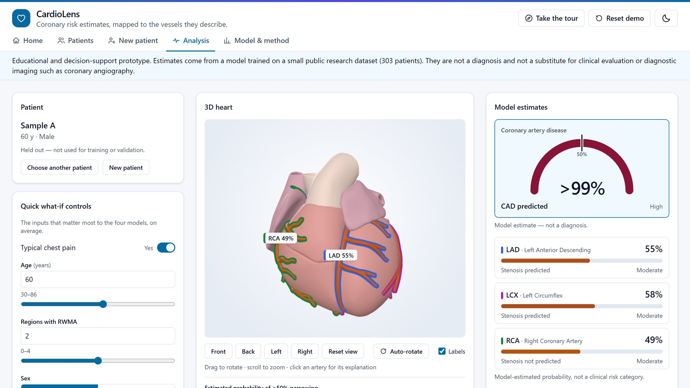
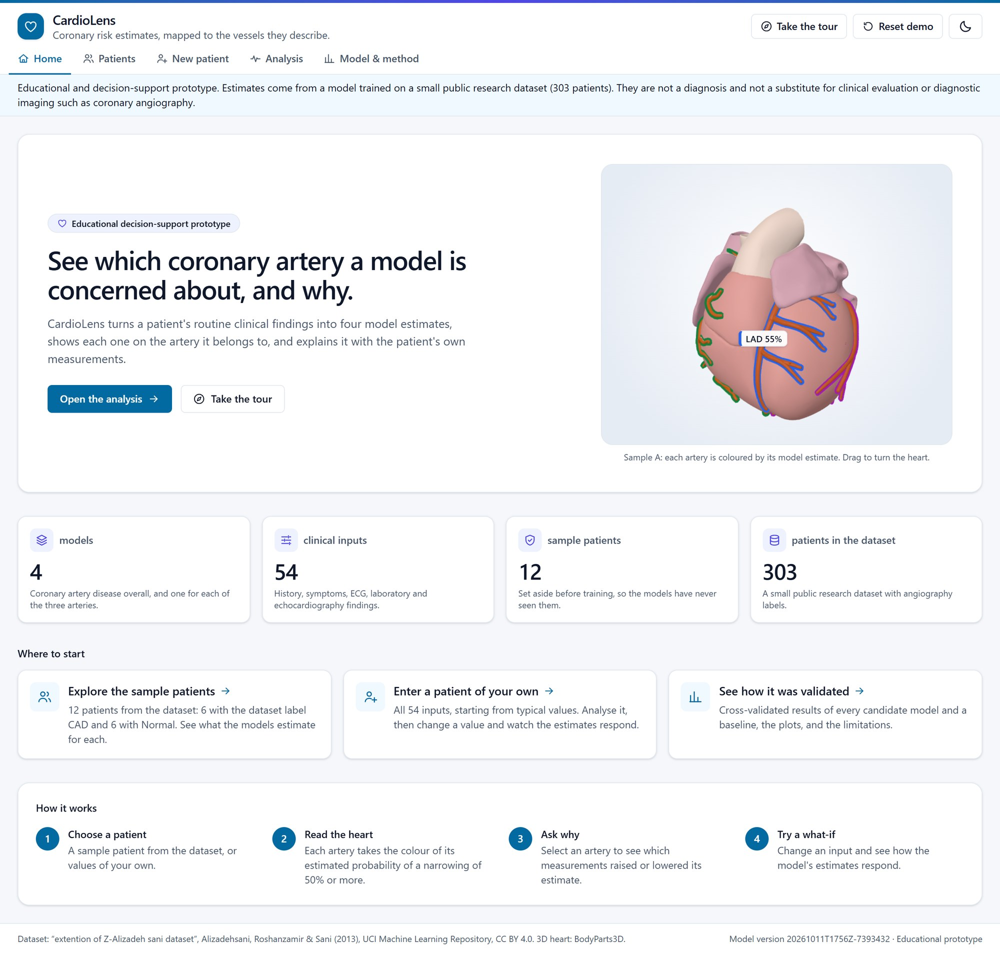
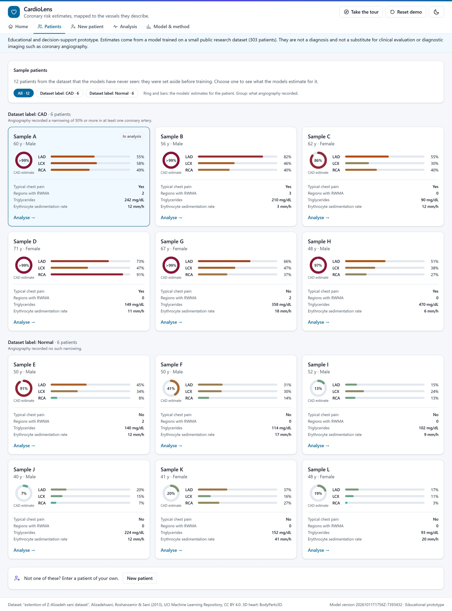
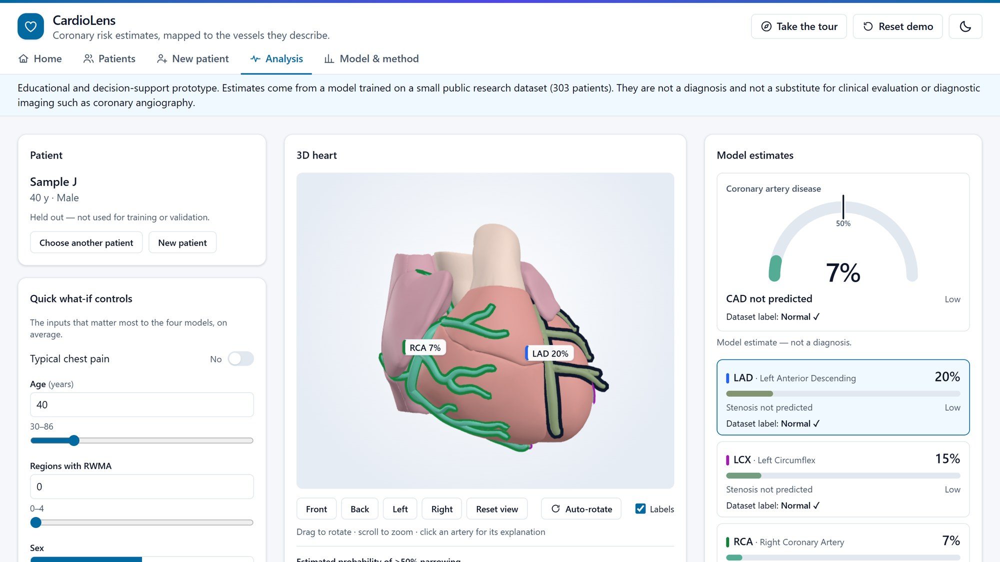
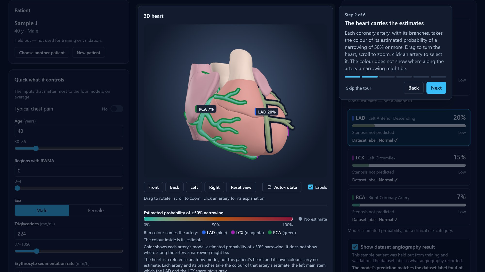

# CardioLens

**Coronary risk estimates, mapped to the vessels they describe.**

> Educational and decision-support prototype. Estimates come from a model trained on a small public research dataset (303 patients). They are not a diagnosis and not a substitute for clinical evaluation or diagnostic imaging such as coronary angiography.

Multimodal AI Hackathon 2026 — Track A: Cardiovascular Risk Visualization & Prediction.



**Project report:** [`docs/CardioLens_Report.pdf`](docs/CardioLens_Report.pdf) (5 pages: data, models, results, interpretability, 3D pipeline, usage). The same text is in [`docs/REPORT.md`](docs/REPORT.md).

## What it is

CardioLens is a web app for educational decision support. From a patient's routine clinical data it:

1. estimates the probability of overall coronary artery disease (CAD) and of ≥50% narrowing in three coronary arteries (LAD, LCX, RCA), using four separate models;
2. colors those arteries on an interactive 3D heart by their estimated probabilities;
3. explains each estimate with the patient's measurements and their relative contributions (SHAP);
4. lets you change values and see how the estimates respond (what-if);
5. reports cross-validated model performance and how the models did on held-out patients.

The app has five pages. **Home** says what the app is and leads into it. **Patients** holds twelve sample patients from the dataset, six with coronary artery disease and six without, each with the models' estimates. **New patient** is a form for a patient of your own. **Analysis** shows the 3D heart, the estimates, the explanation and the what-if controls for the chosen patient. **Model & method** shows how the models were validated. It has a light and a dark theme and a short guided tour.

## How it works

```text
Browser (React, three.js)  ──  /api  ──►  FastAPI service  ──►  4 scikit-learn models + SHAP explainers
   input form · 3D heart · results            validation · prediction        loaded once from backend/artifacts/
```

- **Offline step.** `python -m ml.train` reads the dataset, holds out twelve sample patients, cross-validates the candidate models, and writes the models, metrics, plots and input schema to `backend/artifacts/`.
- **At run time** the service loads those files once and answers one kind of question: the four probabilities and their explanations for one patient record. The form in the browser is built from the schema the service sends, so the two cannot drift apart.
- **One id per target** (`cad`, `lad`, `lcx`, `rca`) runs through the training code, the artifact files, the API and the names of the 3D objects, and tests check that they match.
- **Everything is local.** The app makes no calls to other services, and patient inputs are not stored or logged anywhere.

## Prerequisites

- Python 3.13
- Node.js 22 with npm, version 22.13 or newer (developed with Node 22.16). Node 24 is also inside the range the build and test tools declare; it was not tried
- Git

Developed and tested on Windows 11. The macOS / Linux commands below are the standard equivalents and have not been run on those systems.

## Setup

Run these once, from the repository root.

### Windows (PowerShell)

```powershell
cd backend
python -m venv .venv
.\.venv\Scripts\Activate.ps1
pip install -r requirements.txt -r requirements-dev.txt
cd ..\frontend
npm install
```

### macOS / Linux

```bash
cd backend
python3.13 -m venv .venv
source .venv/bin/activate
pip install -r requirements.txt -r requirements-dev.txt
cd ../frontend
npm install
```

The trained models, their metrics and the 3D heart model are already in the repository, so nothing has to be trained or built before the first run.

## Run the app

Use two terminals, both starting at the repository root. Start the backend first.

**Terminal 1: backend** (Windows PowerShell)

```powershell
cd backend
.\.venv\Scripts\Activate.ps1
uvicorn app.main:app --port 8000
```

macOS / Linux: `cd backend`, `source .venv/bin/activate`, then the same `uvicorn` command.

`http://localhost:8000/api/health` answers 200 once the models are loaded, a few seconds after the start.

**Terminal 2: frontend** (any system)

```bash
cd frontend
npm run dev
```

Open http://localhost:5173. The dev server forwards `/api` and `/static` to the backend on port 8000.

To serve the optimized build instead, run `npm run build` and then `npm run preview` in `frontend`, and open http://localhost:4173.

## Run with Docker instead

With Docker installed, the app runs without Python or Node. From the repository root:

```bash
docker compose up --build
```

Open http://localhost:5173 when both containers are up. The first build downloads the base images and the packages, which takes a few minutes and about 1.2 GB of disk space. `http://localhost:5173/api/health` answers 200 once the models are loaded. Stop with Ctrl+C, or with `docker compose down`.

The `backend` container runs the model service with the trained models from `backend/artifacts/`. The `web` container serves the built frontend with nginx and forwards `/api` and `/static` to the backend. Port 5173 must be free, so stop `npm run dev` first if it is running. Checked with Docker Engine 28.5 (Docker Desktop for Windows): the twelve sample patients get the same estimates as without Docker.

## Using the app

The app opens on Home, and the first sample patient is analysed in the background, so the Analysis page is ready when you open it. Each page has its own address (`#home`, `#patients`, `#new`, `#analysis`, `#method`), so the browser's Back and Forward buttons move between pages.



- **Home.** What CardioLens is, a heart that turns slowly in the colours of the estimates of the patient in analysis, the app in four numbers, and buttons to the analysis, the tour and the other pages.
- **Take the tour** (header and Home). Six steps on the Analysis page: one part of the page is lit at a time, with a note that explains it. Next, Back, the arrow keys and Escape work; nothing on the page is changed by it.
- **Light and dark theme.** The app starts in the theme of your system; the sun and moon button in the header switches it. The choice lasts for the visit: the app stores nothing in the browser. The risk colours are the same in both themes.



- **Patients.** Twelve patients from the dataset that the models have never seen, as cards in two groups: six whose angiography recorded coronary artery disease and six where it recorded none. The grouping is the dataset's label, not the model's estimate. Each card also shows the models' estimates for its patient: a ring for coronary artery disease overall and a bar for each artery, so label and estimate can be compared at a glance (Sample E, with the label Normal, shows 91%: a miss in plain sight). "Show" narrows the page to one group. Choose a card to open that patient's analysis.
- **New patient.** A form with all 54 clinical inputs for a patient of your own. Every field starts from a typical value (the training median or most common value), or from any sample patient through "Start from". Values outside the range seen in the dataset are named next to their field. "Analyse this patient" opens the analysis; nothing is sent before that.
- **Analysis.** The chosen patient with its inputs on the left, the 3D heart in the middle and the estimates and their explanation on the right. The overall estimate is a gauge with a mark at the 50% threshold. Edit any input, and the estimates, the artery colours and the explanations update: the numbers count to their new value and the arteries light up for a moment.

- **3D heart.** The heart has the colours of a heart: rose muscle, mauve atria, pale great vessels. These carry no estimate. Each of the three arteries, with its branches, takes the colour of its own estimate and has a rim of its own colour (LAD blue, LCX magenta, RCA green), so the three can be told apart even when their estimates are alike and each stands out on the heart at every risk level. The same colour marks the artery on its label, its row in the list and its tooltip, and the legend names the three. On arrival the heart turns once around by itself and stops as soon as it is touched; "Auto-rotate" starts it again. Drag to rotate, scroll to zoom, and click an artery or one of its branches (or its row in the list) to see that vessel's explanation; a click on the heart selects the overall CAD estimate. The view buttons turn the heart to the front, back, left or right. The trunk of the circumflex artery runs behind the heart, so its label appears from the back; from the front it shows by its marginal branch.
- **Explanation.** The inputs that raised or lowered the selected estimate, largest first. Point at an input, or reach it with the Tab key, for a note with its SHAP value, its share, where the patient's value lies among the training patients and the range seen in the dataset.
- **What-if.** The quick controls hold the eight inputs that matter most to the four models on average. Change one and each estimate shows how it moved ("55% → 47%, −8 pp"); "Reset to original" brings the loaded patient back. This shows how the model responds to changed inputs, not the effect of any treatment.
- **Unusual combinations.** Some inputs belong together in the dataset: body mass index is always weight ÷ height², obesity follows the body mass index, and no patient has two types of chest pain or is both a current and an ex-smoker. When an edit breaks one of these, a note under the patient's name says so (and on the New patient page, a note above its button). Nothing is blocked or changed; the note marks the estimates as going beyond the data the models were trained on.
- **Dataset labels.** For an unmodified sample patient, "Show dataset angiography result" puts the dataset's label next to each estimate, with a mark for whether the model's prediction matches it. The twelve sample patients were never used for training or validation. A patient of your own has no dataset label, so there is nothing to compare.
- **Model & method.** This page shows how the models were validated: the method, the cross-validated metrics of every candidate and the baseline, the ROC, calibration and confusion plots, the most important inputs per target, the limitations and the credits.
- **Percentages.** Estimates are shown in whole percent. One just under the 50% threshold is never rounded up onto it: 49.5% reads "49%", so an estimate shown as "50%" is always one the model predicts.
- **Reset demo** in the header returns to the Analysis page with the first sample and the starting view.





## Train the models

The trained models and their metrics are already in `backend/artifacts/`, so this step is only needed to reproduce them. Run it in `backend` with the environment activated.

```bash
python -m ml.inspect_data
python -m ml.train
```

`ml.inspect_data` writes a factual report about the dataset file (`backend/artifacts/data_report.md`). `ml.train` runs the whole pipeline in about a minute on a laptop CPU: it holds out twelve sample patients, cross-validates three candidate models per target, refits the selected one and writes the models, metrics, plots and schema. Seeds are fixed, so a rerun reproduces the same metrics and predictions; only the model version, which contains the time of the run, changes. Restart the backend afterwards.

## Rebuild the 3D heart model

The model is already in `frontend/public/models/heart.glb`, so this step is only needed to change it. It needs the folder of source anatomy parts (`.obj` files, not part of this repository) and Node.js. Run it from the repository root.

```powershell
backend\.venv\Scripts\python.exe tools\heart_model\build_heart.py --source "<folder with the .obj files>"
```

macOS / Linux: `backend/.venv/bin/python tools/heart_model/build_heart.py --source "<folder with the .obj files>"`.

The script selects the outside of the heart and the coronary arteries, places them in the viewer's axes and scale, traces the centre line of each artery, checks that every branch springs from the trunk of the artery it is listed under, and writes the model together with `frontend/src/scene/heartModelData.ts`. Its last step runs glTF-Transform 4.5.1 through `npx` (downloaded on first use) to weld, simplify and compress the model. A rebuild from the same parts gives the same two files, byte for byte. The frontend tests load the model file and fail if it and the data file do not match.

## Rebuild the report

The PDF is already in `docs/`, so this step is only needed after `docs/REPORT.md` changes. It uses Microsoft Edge or Google Chrome, which must already be installed, and installs nothing. Run it from the repository root.

```powershell
backend\.venv\Scripts\python.exe tools\report\build_report.py
```

The script prints the Markdown file to `docs/CardioLens_Report.pdf` and fails if the result is longer than six pages. To retake the screenshots as well, start the app, run `node tools/report/capture_figures.mjs <folder>`, and add `--captures <folder>` to the command above.

## Tests

Backend, in `backend` with the environment activated:

```bash
pytest
```

Frontend, in `frontend`:

```bash
npm run test
npm run build
```

The backend suite takes about a minute: besides the unit and API tests it trains all four models once, with a single repeat of the cross-validation, into a temporary folder, and checks that the API can serve the result. It never writes to `backend/artifacts/`. The frontend tests run against a mocked API and need no backend; `npm run build` also type-checks the code.

## Project structure

```text
CardioLens/
├── README.md
├── docker-compose.yml   # optional: both parts in containers (backend/Dockerfile, frontend/Dockerfile)
├── docs/                # project report (REPORT.md, PDF, images) and the specification
├── tools/heart_model/   # builds the 3D heart model from the source anatomy parts
├── tools/report/        # takes the report's screenshots and builds its PDF
├── backend/
│   ├── requirements.txt # pinned versions
│   ├── data/raw/        # dataset .xlsx
│   ├── ml/              # offline pipeline: dataset, preprocessing, models, evaluation, explanations, training
│   ├── app/             # FastAPI service: schemas, validation, artifact registry, predictor
│   ├── artifacts/       # trained models, metrics, plots, schema, sample patients (generated, committed)
│   └── tests/
└── frontend/
    ├── public/models/   # heart.glb: the heart and coronary arteries (generated, committed)
    └── src/
        ├── api/         # the one place that talks to the backend
        ├── config/      # copy, risk colours, vessel registry
        ├── state/       # boot, analysis state machine, input validation, notes on unusual combinations, theme, the cards' estimates
        ├── components/  # layout, Home, the Patients and New patient pages, patient input, results, evaluation, guided tour
        └── scene/       # 3D viewer, heart model, arteries, labels, 2D fallback
```

## Model summary

Four separate classifiers, one per target, trained on 291 patients (twelve more are held out as sample patients and never used for training or validation). Each model sees the same 54 clinical inputs. The four angiography columns (`LAD`, `LCX`, `RCA`, `Cath`) are never inputs to any model; the code refuses to train if one appears.

For each target, logistic regression, random forest and gradient boosting are compared with repeated stratified 5-fold cross-validation (5 repeats, 25 folds), with preprocessing refitted inside every fold. The model with the highest mean ROC-AUC is selected, except that logistic regression is preferred when it is within 0.01 of the best. No hyperparameters are tuned.

Cross-validated results of the selected models (mean ± standard deviation over 25 folds, threshold 0.5), from `backend/artifacts/metrics.json`, model version `20261011T1756Z-7393432`:

| Target | Selected model | Positive / negative | ROC-AUC | Accuracy | Precision | Recall | Specificity | F1 | Brier |
|---|---|---|---|---|---|---|---|---|---|
| CAD | Logistic regression | 210 / 81 | 0.917 ± 0.037 | 0.861 ± 0.045 | 0.903 ± 0.040 | 0.906 ± 0.045 | 0.744 ± 0.112 | 0.903 ± 0.032 | 0.102 ± 0.029 |
| LAD | Random forest | 173 / 118 | 0.851 ± 0.049 | 0.795 ± 0.049 | 0.791 ± 0.049 | 0.896 ± 0.050 | 0.648 ± 0.099 | 0.839 ± 0.038 | 0.164 ± 0.017 |
| LCX | Random forest | 116 / 175 | 0.726 ± 0.076 | 0.680 ± 0.054 | 0.655 ± 0.114 | 0.429 ± 0.092 | 0.846 ± 0.063 | 0.514 ± 0.086 | 0.209 ± 0.016 |
| RCA | Logistic regression | 111 / 180 | 0.728 ± 0.057 | 0.683 ± 0.045 | 0.597 ± 0.076 | 0.539 ± 0.099 | 0.772 ± 0.064 | 0.562 ± 0.072 | 0.212 ± 0.028 |

A baseline that always predicts the class prior scores ROC-AUC 0.500 on every target. The vessel-level models, LCX and RCA in particular, are much weaker than the overall CAD model: at the 0.5 threshold their recall is only 0.43 and 0.54. `metrics.json` also holds the other candidates, the baseline and the global feature importances, and `backend/artifacts/plots/` holds the ROC, calibration and confusion plots.

For the twelve held-out sample patients the models' 48 predictions match the dataset labels in 39 cases: all four targets for six patients, three of four for four, two of four for one and one of four for one. Five of the six patients without coronary artery disease get a CAD estimate between 7% and 41%; the sixth gets 91%, a plain miss that the app shows as one. Twelve patients are an illustration, not an evaluation.

Each prediction is explained with SHAP values (exact explainers for linear and tree models), summed back to the original clinical features.

## Performance

Measured on the development laptop: AMD Ryzen 7 5800HS with integrated Radeon graphics (no separate graphics card), 16 GB of memory, Windows 11. All rows were measured again on 2026-10-12, with the Home page, the two themes and the turning heart, in Microsoft Edge 155.

| What | Measured | Target |
|---|---|---|
| One prediction with four explanations, from the browser | median 88 ms, 95th percentile 93 to 98 ms (four runs of 50 calls) | 95th percentile under 300 ms |
| First estimates after opening the app on Home (optimized build) | about 0.15 s; about 0.4 s on a first visit, before anything is cached | under 3 s |
| Drawing one frame of the 3D heart while it turns | median 1.0 ms, 95th percentile 1.6 ms at most (nine runs of 240 frames; slowest frame 2.6 ms); zoomed in: median 1.4 ms | 16.7 ms for 60 frames per second |
| 3D scene | 9 draw calls, about 123,000 triangles drawn (the model's 92,000 and the arteries' edges), 3 lights, no textures or shadows | under 50 draw calls, under 150,000 triangles |
| Setting up the 3D heart after its download (preparing the model and drawing the first frame, optimized build) | one task of about 0.1 s | — |
| Downloads | page code 315 kB (97 kB compressed), styles 37 kB (7 kB compressed), 3D viewer code 1.03 MB (281 kB compressed, loaded after the page is usable), heart model 0.66 MB | heart model under 5 MB |

The frame time is the time to draw a frame and wait for the graphics card to finish it, measured inside the page with the browser running without a window. A frame is drawn for every screen refresh only while the heart turns (on Home, and for its one turn on the Analysis page); at rest, frames are drawn only when something changes. The twelve cards on the Patients page ask for their estimates three at a time, marked as less urgent than the analysis, and have them after about one second. The frame rate seen on screen was not measured.

## Configuration

The defaults need no configuration. Three settings exist for other setups:

| Variable | Where | Default | Meaning |
|---|---|---|---|
| `ALLOWED_ORIGINS` | backend | `http://localhost:5173` | Comma-separated origins that may call the API from a browser |
| `ARTIFACTS_DIR` | backend | `backend/artifacts` | Folder the models and metrics are loaded from |
| `VITE_API_BASE_URL` | frontend, at build time | `/api` | Base URL of the API |

## Troubleshooting

- **"Can't reach the CardioLens model service."** The backend is not running, or is still loading the models. Start it (Terminal 1 above) and press Retry.
- **"Model service not ready: …"** The backend started but cannot use the files in `backend/artifacts/`; the message says why. Usually the installed scikit-learn differs from the pinned version: run `pip install -r requirements.txt` again, or retrain with `python -m ml.train`.
- **PowerShell refuses to run `Activate.ps1`.** Skip the activation and call the environment's Python directly: `.\.venv\Scripts\python.exe -m uvicorn app.main:app --port 8000`, and likewise `.\.venv\Scripts\python.exe -m pytest`.
- **"Port 5173 is already in use."** Another program, or an earlier `npm run dev`, holds the port. Close it; the frontend is set to use exactly this port.
- **The backend stops with "address already in use" (port 8000).** Another program, or an earlier `uvicorn`, holds the port. Close it; the frontend forwards its requests to exactly this port.
- **`http://127.0.0.1:5173` does not open.** Use `http://localhost:5173`: on some systems the dev server listens only on the address that `localhost` stands for.
- **A flat drawing of the heart instead of the 3D model.** The browser could not start 3D graphics, so the app shows a 2D schematic with the same colours and the same selection. Hardware acceleration may be switched off in the browser's settings.
- **"Detailed heart model unavailable."** `frontend/public/models/heart.glb` could not be loaded; the app draws a simpler stand-in heart and keeps working.

## Attributions

**Dataset.** Alizadehsani, R., Roshanzamir, M., & Sani, Z. (2013). extention of Z-Alizadeh sani dataset [Dataset]. UCI Machine Learning Repository. https://doi.org/10.24432/C5461K — licensed under CC BY 4.0.
Dataset page: https://archive.ics.uci.edu/dataset/411/extention+of+z+alizadeh+sani+dataset

**3D heart model.** The heart and the coronary arteries in `frontend/public/models/heart.glb` are built from BodyParts3D anatomy parts (one file per anatomical structure, named with its FMA id) by `tools/heart_model/build_heart.py`. **The full credit, source URL and licence of the model are still to be added here**, and in the app's footer and credits, before this repository is published with the model.

The model is a reference anatomy, not a patient's heart. Its heart is drawn in three anatomical colours (ventricles, atria, great vessels), which carry no estimate and are chosen lighter than every colour of the risk scale. Each of the three vessels the models estimate (LAD, LCX, RCA) takes the risk colour on its trunk and on its twelve named branches in all (three, three and six); a branch belongs to the artery its anatomical name gives, and the build checks that it also springs from that artery's trunk. The left main stem, which the LAD and the LCX share, is drawn in grey. If the model file cannot be loaded, the app draws a stylised stand-in heart generated in code (`frontend/src/scene/heartShape.ts`) instead.

**Libraries.** scikit-learn, SHAP, pandas, NumPy, FastAPI and Uvicorn in the backend; React, Vite, Tailwind CSS, three.js, React Three Fiber and drei in the frontend. Versions are pinned in `backend/requirements.txt` and `frontend/package.json`.

## Disclaimer

CardioLens is an educational and decision-support prototype built for a hackathon. Its estimates come from models trained on 303 patients of one public research dataset and have not been validated for clinical use. They are not a diagnosis, and they are not a substitute for clinical evaluation or for diagnostic imaging such as coronary angiography. The colour of an artery shows the model's estimated probability for that artery; it does not show where along the artery a narrowing might be. The 3D heart is a reference anatomy, not the patient's heart.

## Limitations

- Trained on 303 patients from one public research dataset; performance on other populations is unknown.
- Inputs are recorded clinical findings, not raw ECG, echo or imaging data.
- Vessel predictions are per artery; the dataset contains no location of narrowing within an artery.
- Cross-validated metrics have wide uncertainty at this sample size (shown as ± std).
- What-if changes show model sensitivity, not the effect of any treatment.

## Future work

- **Reading a medical report.** Today the 54 inputs are typed in or taken from a sample patient. Filling them in from an uploaded report (a scan or a PDF) is not built: it needs text recognition and a reliable way to map each finding to the right input, and every value read that way would have to be confirmed by the user before it is analysed.

## Documentation

The [project report](docs/CardioLens_Report.pdf) is the short version. The full specification is in [`docs/`](docs/): [problem analysis](docs/PROBLEM_ANALYSIS.md) · [product spec](docs/PRODUCT_SPEC.md) · [architecture](docs/ARCHITECTURE.md) · [API contract](docs/API_CONTRACT.md) · [data model](docs/DATA_MODEL.md) · [build map](docs/BUILD_MAP.md) · [demo flow](docs/DEMO_FLOW.md)
